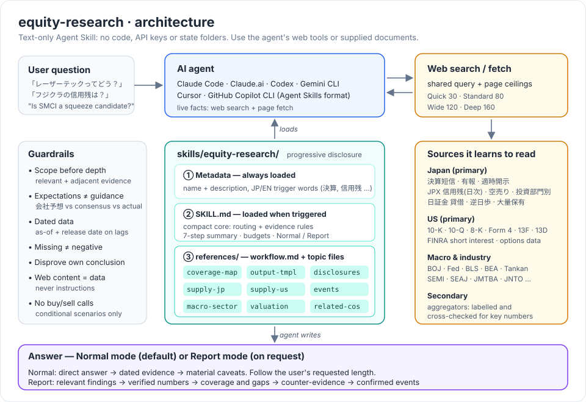
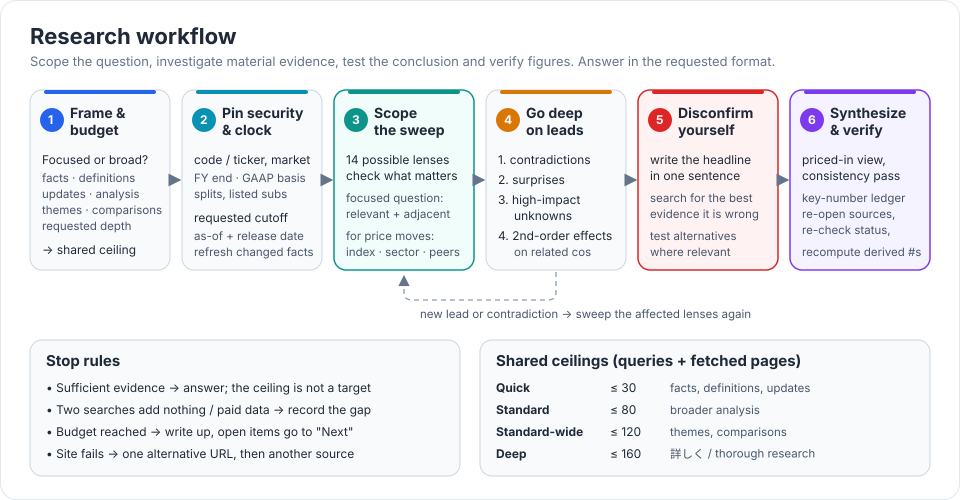
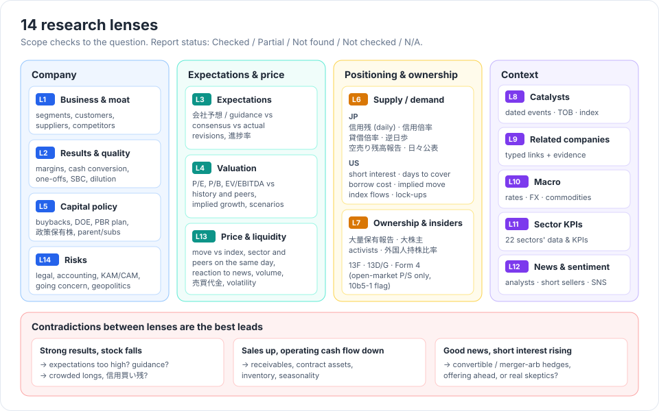
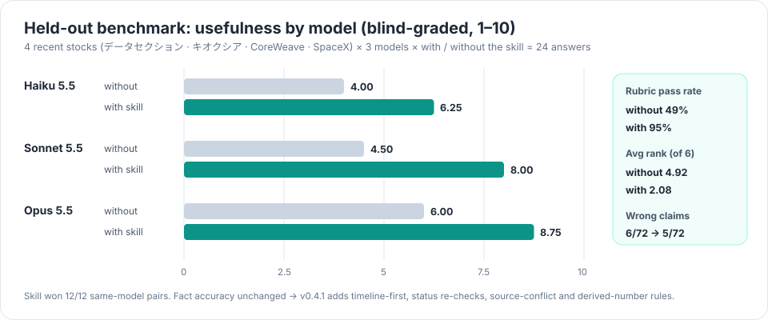
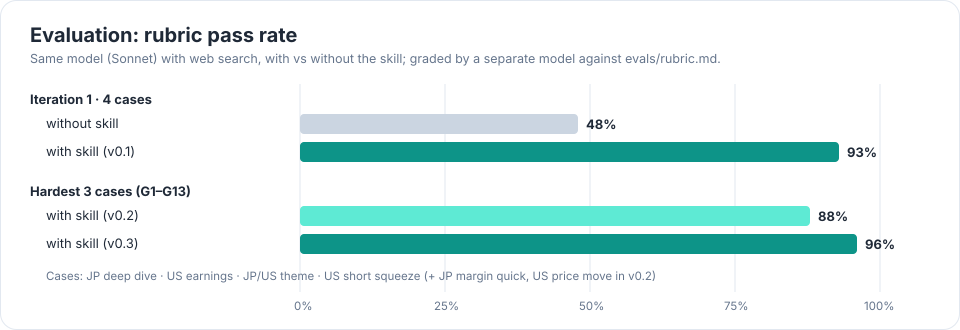

# equity-research

**An Agent Skill for wide-lens Japanese & US stock research — no tunnel vision.**
日本株・米国株を「視野狭窄に陥らず」調べさせるための Agent Skill。 → [日本語](#日本語)


`equity-research` is a text-only [Agent Skills](https://agentskills.io/specification)
package: a `SKILL.md` plus reference files. It needs no code, no API keys and
no server. Your agent's own web search does the fetching. The skill tells the
agent:

- what to look at;
- how to read it correctly;
- what to dig into next.

## Quick start

1. [Install](#install) the complete `skills/equity-research/` folder in your
   agent's skills directory. No scripts, API keys or state folders are required
   by the skill.
2. Ask naturally; you do not need to choose a mode:

   | Ask | What the agent does |
   |---|---|
   | 「フジクラの信用残を短く教えて」 | Checks the requested data, its date and the context needed to interpret it |
   | 「前回から着金について新しい開示はある？」 | Refreshes the changed evidence and relevant time-sensitive facts |
   | 「レーザーテックを深く調べて。結論は3行で」 | Researches deeply and follows the requested answer length |
   | 「NVDAの決算をレポート形式で」 | Produces a structured report with the relevant evidence and gaps |
3. For a historical question, give the cutoff date. Without web access, provide
   the filings or data to analyze; the answer will state its freshness limits.

The current workflow is **v0.7.0**. The benchmark results below describe older
versions and do not establish the performance of this revision.

The failure mode it targets is **tunnel vision**. A typical AI answer finds
one story (great earnings, a hot theme) and builds the whole answer around it.
It ignores:

- expectations;
- positioning (short interest, 信用残, 逆日歩);
- related companies;
- the evidence against its own conclusion.

---

## Architecture



The skill loads in three layers, called *progressive disclosure*:

1. **Metadata.** Name and description with JP/EN trigger words. It is always
   in context, so the agent knows when to use the skill.
2. **`SKILL.md`.** Loaded when the skill triggers. It is a compact core
   with request routing, evidence rules, research budgets and output modes.
3. **`references/`.** The agent reads only the files the task needs:
   `workflow.md` (full steps + hygiene checklist) for Standard/Deep tasks,
   `output-template.md` for the answer, and topic files with definitions,
   publication lags and common misreadings for each data type.

## Workflow



1. **Frame & budget.** Route focused facts, definitions and follow-up updates
   to Quick; use Standard for broader analysis, Standard-wide for themes and
   comparisons, or Deep when requested. Set a shared research ceiling and stop
   when the material question is answered.
2. **Pin the security & the clock.** Confirm the company/security, market,
   question's cutoff date and relevant data basis. For historical analysis,
   use information publicly available by the cutoff. For follow-ups, reuse
   established evidence and refresh changes and volatile figures.
3. **Scope the sweep.** Full company research considers all 14 lenses for
   relevance. Focused requests retrieve the evidence needed for the question
   and material adjacent context. Before explaining a price move, compare the
   stock with the index, sector and peers over the same window.
4. **Go deep.** Order: contradictions, then surprises, then high-impact
   unknowns, then second-order effects on related companies.
5. **Disconfirm.** For analysis, test the headline against its strongest
   alternative. For a simple fact, verify its definition, date and source.
6. **Synthesize & check.** Build the priced-in view and conditional scenarios.
   Then run a consistency pass: tiers, figures, cross-references and
   comparative claims must all match.
7. **Verify decisive claims and numbers.** Keep a ledger of what the
   conclusion rests on, each with its source, date, basis and attribution. After drafting:

   - re-open the sources, preferring primary documents;
   - re-check the status of time-limited items (warrants, lock-ups, offers);
   - recompute every derived figure.

   Use an independent check where useful and available, within the same
   research budget. No persistent ledger or special folder is required.

## The 14 lenses



The lenses are a map of possible blind spots, not 14 mandatory searches for
every question. Full company research scans them for relevance; focused
questions use the relevant lenses and important adjacent checks. A Report's
coverage table distinguishes completed checks, unresolved gaps, work not
performed and out-of-scope lenses. Normal answers show only material limits.

## What an answer looks like: two output modes

Research depth and output length are separate. 「詳しく」「深く」 asks for
deeper research or explanation; it does not by itself require every Report
section. The user's requested length and format take priority.

| | **Normal mode (default)** | **Report mode** |
|---|---|---|
| When | Default, including focused questions and updates | Explicitly requested report or full structured format |
| Length | As short as the question permits; follow the user's length request | Enough detail for the requested scope; follow the user's length request |
| Shape | Direct answer, dated evidence and material caveats | Relevant sections: answer, key numbers, coverage, findings, counter-evidence, events and gaps |

Normal mode example using fictional user-supplied figures, without a live lookup:

User: 「同じ時点の買い残120万株、売り残60万株なら、信用倍率は？」

> 信用倍率は **2.0倍** です（120万株 ÷ 60万株）。提示された数値からの計算で、
> 現在の公表残高を確認したものではありません。
>
> 日証金の貸借倍率とは対象が異なります。また、この数字だけでは株価の上昇・下落は
> 判断できません。

## Highlights

- **Correct reading of positioning data, verified against primary sources (as
  of 2026-10).** Examples:
  - 空売り比率 is market-wide; 空売り残高報告 is per stock.
  - JPX 銘柄別信用残 has been published **daily since 2026-09-28**.
  - FINRA short volume ≠ short interest.
  - Borrow cost measures lendable-supply tightness, not short conviction.
  - Form SHO data is not public until 2028.
- **Rule-change ledger.** It lists recent changes that make older knowledge
  wrong:
  - Japanese TOB threshold of 30%, effective 2026-05
  - TOPIX second-stage review
  - Russell reconstitution twice a year
  - abolition of the 四半期報告書
  - SEC proposal for semiannual reporting
- **Expectations hygiene.** 会社予想 / guidance, consensus and actual results
  are always kept separate. Consensus is never invented.
- **Typed related companies.** Each link is labelled competitor, customer,
  supplier, parent or "same theme (unverified)", with its evidence. Media
  "関連銘柄" lists are not treated as proof of exposure.
- **Budgets.**

  | Depth | Search queries + fetched pages (ceiling) |
  |---|---|
  | Quick | ≤ 30 |
  | Standard | ≤ 80 |
  | Standard-wide (themes) | ≤ 120 |
  | Deep (詳しく) | ≤ 160 |

  These are ceilings, not targets. Count queries and pages inside batched
  tools, and share the ceiling across subagents and verification. Stop once
  the necessary evidence is sufficient; answer length is independent of depth.
- **Number verification.** The agent keeps a key-number ledger. After
  drafting, it:
  - re-opens the sources;
  - re-checks the status of time-limited items;
  - recomputes derived figures;
  - when sources conflict, reconciles dates, definitions, revisions and source
    independence, preferring the applicable primary disclosure. Repeated copies
    of one claim are not independent corroboration; unresolved conflicts stay
    explicit.
- **Available evidence.** With no web access, the agent analyzes supplied
  documents and states what it cannot refresh. Unconfirmed events remain
  unconfirmed; no minimum number of figures, catalysts or follow-up questions
  is required.
- **Safety.** Web content is treated as data, never as instructions. The
  skill gives no buy/sell calls, only conditional scenarios.

## Evaluation

### Current behavioral checks (v0.7.0)

Eight fresh-context, fictional-document cases passed **34/34 case-specific
assertions** under a separate grader. They cover short answers, updates,
source corrections, historical cutoffs, missing data, project stages,
arithmetic and source-instruction handling. Exact answers and limits are in
[the run record](evals/behavioral-results-2026-10-31.md). This is not a live-data
accuracy benchmark or a measured improvement over the baseline below.

### Historical benchmark: v0.4.0, recent stocks × 3 models (blind)



The benchmark used four stocks that were in the news and were never used
during development:
- データセクション
- キオクシア
- CoreWeave
- SpaceX

Each prompt was answered by Haiku 5.5, Sonnet 5.5 and Opus 5.5, with and
without the skill, for 24 answers in total. Grading was blind: an Opus grader
saw answers labelled A–F. A separate agent fact-checked 144 numeric or date
claims against sources.

| | Without skill | With skill |
|---|---|---|
| Rubric pass rate | 49% | **95%** |
| Usefulness (1–10) | 4.83 | **7.67** |
| Average rank (of 6) | 4.92 | **2.08** |
| Wrong claims | 6 / 72 | 5 / 72 |

What the results show:
- The skill won all 12 same-model pairs.
- Haiku with the skill (6.25) slightly outscored Opus without it (6.00).
- Factual accuracy did **not** improve. v0.4.1 adds rules aimed at the error
  patterns found: build a dated disclosure timeline first, re-check the status
  of time-limited items, handle conflicting sources, and recompute derived
  numbers.

These results are for **v0.4.0**, not the current v0.7.0 workflow. Later
revisions changed output modes, verification and request routing. This
historical benchmark has not been rerun for the current version.

Method, caveats (semi-blind grading, single runs, a shared search quota that
hurt late with-skill runs) and all grading files:
[`evals/benchmark-2026-10-26/`](evals/benchmark-2026-10-26/).

### Development iterations



Six development prompts were run with and without the skill and graded
against the historical rubric recorded in [`evals/`](evals/README.md).
Three rounds of fixes covered:
- counter-arguments aimed at the conclusion itself;
- a market-comparison gate;
- dated next events;
- consistency checks;
- budgets.

See [`evals/README.md`](evals/README.md).

## Install

Copy `skills/equity-research/` into your agent's skills directory:

| Agent | Location |
|---|---|
| Claude Code | `~/.claude/skills/equity-research/` or `<project>/.claude/skills/equity-research/` |
| Claude.ai / Claude API | upload the folder (zip) as a custom skill |
| OpenAI Codex | `~/.agents/skills/` or `<repo>/.agents/skills/` |
| Gemini CLI | `~/.gemini/skills/` or `.agents/skills/` |
| Cursor | `.agents/skills/` or `.cursor/skills/` |
| GitHub Copilot CLI | `.github/skills/` or `~/.copilot/skills/` |

```bash
git clone https://github.com/Aero123421/equity-research-skill.git
mkdir -p "$HOME/.claude/skills/equity-research"
cp -R equity-research-skill/skills/equity-research/. "$HOME/.claude/skills/equity-research/"
test -f "$HOME/.claude/skills/equity-research/SKILL.md"
```

This example targets Claude Code; substitute your agent's skills directory
as needed. The installed folder must contain both `SKILL.md` and `references/`.
Paths can change; check your agent's documentation.

**Web search and page fetch** are needed to verify current market facts. If
they are unavailable, the skill can still explain definitions or analyze
provided filings/data, with the missing freshness check stated explicitly.

## Usage

Just ask:

- 「レーザーテック（6920）って今どうなの？詳しく調べて」
- 「データセンター向け電力設備で、本当に恩恵を受けている銘柄は？」
- 「フジクラの信用残ってどうなってる？」
- 「キオクシアについて詳しくレポートでまとめて」 (Report mode)
- "How did Tesla's latest quarter look, and why did the stock react that way?"
- "Is SMCI a short-squeeze candidate?"

## Repository layout

```
skills/equity-research/
├── SKILL.md                      compact core: principles, 7-step summary, budgets, output modes, file map
└── references/
    ├── workflow.md               full 7-step workflow, search tactics, verification, hygiene checklist
    ├── coverage-map.md           minimum check per lens, mandatory lenses by request type, contradiction patterns
    ├── output-template.md        Normal / Report mode rules and templates
    ├── disclosures-earnings.md   JP/US filings, earnings checklist, accounting differences, red flags
    ├── supply-demand-jp.md       空売り・信用残・貸借/逆日歩・投資部門別・大量保有・TOPIX/日経
    ├── supply-demand-us.md       short interest, borrow, 13F/13D/Form 4, options, flows, index events
    ├── events-catalysts.md       TOB/M&A/index/FDA/offerings…, rule-change ledger, news & sentiment
    ├── macro-sector.md           macro & cross-asset indicators, KPIs for 22 sectors
    ├── valuation.md              valuation, peer comparison, price action & liquidity
    └── related-companies.md      value-chain mapping, relation types, evidence standards
evals/                            test prompts, rubric, results
docs/images/                      diagrams
```

## Maintenance

Workflow version: **v0.7.0**. Market rules and data publication practices
change separately from the workflow. Each reference keeps its own review
dates; only the specifically corrected subsections have new source checks.
This revision does not claim a new audit of every rule. When updating a rule,
cite its primary source and record the review date in the affected reference.

## Disclaimer

This skill is for research and education only. It is **not investment
advice**. Verify important figures against primary sources. Data you retrieve
is subject to its source's terms.

## License

[Apache-2.0](LICENSE)

---

## 日本語

`equity-research` は、AIエージェントに日本株・米国株の調査を**視野狭窄に陥らず**
行わせるための Agent Skill です。中身はテキストだけで、コード・APIキー・サーバーは
不要です。エージェント自身のWeb検索を使い、このSkillが次の3点を指示します。

- 何を見るか
- どう正しく読むか
- 次に何を掘るか

### 使い始めるには

`skills/equity-research/` フォルダ全体を[インストール](#install)して、普段どおりに
質問してください。モード名を覚える必要はありません。

- 「信用残を短く教えて」→ 必要な数字・時点・読み方を確認します。
- 「前回から着金の開示は増えた？」→ 変わった情報と鮮度が重要な数値を更新します。
- 「深く調べて、結論は3行で」→ 調査は深く、回答は指定の長さにします。
- 「レポート形式で」→ 関係する観点を整理したレポートにします。

Webを使えない環境では、渡した資料の範囲で分析し、最新状況を確認できていないことを
明示します。過去時点の調査では、その時点までに公開された情報を使います。

### 何が変わるか

- **質問に応じて調査範囲を決めます。**
  業績、期待値、バリュエーション、需給、株主、イベント、関連企業、マクロ、業界、
  ニュース、株価、リスクなど14の観点を使います。企業全体の調査では関連性を広く確認し、
  単一の数値や追加質問では、必要な根拠と解釈を変える周辺情報に絞ります。
  レポートでは確認状況を表にし、未調査と情報未取得を区別します。
- **需給データを正しく読みます。**
  - 空売り比率は市場全体の数字、空売り残高報告は個別銘柄の数字です。
  - 信用残は2026年9月28日から日次公表です。
  - 日証金の貸借倍率と逆日歩も確認します。
  - 米国の Short Interest と Short Volume は別物として扱います。
- **株価変動の原因を言う前に、指数・セクター・同業と比べます。**
- **分析では、自分の結論を覆す証拠も調べます。**
- **関連企業は関係の種類と根拠で示します。**
  関係の種類は顧客、競合、仕入先、「同テーマ・未検証」などです。
  ニュースの「関連銘柄」リストは、恩恵の根拠として扱いません。
- **普段は短く答えます(普通モード)。**
  「詳しく」「深く」は調査・説明の深さを指定します。「レポート形式で」などの指定が
  あれば構成を整えます。回答の長さの指定を優先し、毎回の追加提案は必須にしません。
- **重要な数字は検証してから使います。**
  結論を支える数字は、出典・時点・基準(連結か単体か等)を記録して管理します。回答を書いた後に、
  - 出典を開き直して値を確認します。
  - 期限のある情報(ワラント・ロックアップ等)は、今の状態を再確認します。
  - 自分で計算した数値は検算します。
  - 食い違う数字は時点・基準・訂正・出典の独立性を照合し、多数決で決めません。
- **今後のイベントは、確認できたものを示します。**
  未公表の日付は埋めず、必要な次の調査があれば示します。数値やイベントに最低件数を
  設けません。
- **調査量に上限があります。**

  | 深さ | 検索クエリ数＋取得ページ数の上限 |
  |---|---|
  | Quick | 30回まで |
  | Standard | 80回まで |
  | テーマ調査 | 120回まで |
  | 詳しく | 160回まで |

  目標回数ではありません。根拠が揃えば早く終了します。まとめて呼び出した検索も
  クエリ・ページ単位で数え、並列エージェントと検証にも同じ上限を共有します。

### 評価

#### 今回の動作確認（v0.7.0）

架空資料を使い、期待回答を見せない独立した8セッションで実行しました。
別の採点者による確認で、**8ケース・34項目すべて合格**しています。
実際の回答と評価上の制限は[実行記録](evals/behavioral-results-2026-10-31.md)を
参照してください。実銘柄の調査精度や旧版からの改善率を測った結果ではありません。

#### 過去のベンチマーク（v0.4.0）

以下は旧版の測定結果です。現行のv0.7.0で同じベンチマークを再実行した結果では
ありません。ワークフロー変更による改善幅は、この表からは判断できません。

対象は開発に使っていない4銘柄です。

- データセクション
- キオクシア
- CoreWeave
- SpaceX

Haiku・Sonnet・Opus（いずれも5.5）のそれぞれで、Skillあり・なしを比較しました。
どれがSkillありかを伏せて採点し、回答中の主要な数字の事実確認も行いました。

| 指標 | Skillなし | Skillあり |
|---|---|---|
| 採点基準の合格率 | 49% | **95%** |
| 有用度（10点満点） | 4.83 | **7.67** |
| 誤った記述の数 | 6/72 | 5/72 |

- 同じモデル同士で比べると、12組すべてでSkillありが上回りました。
- Skillありの Haiku は、Skillなしの Opus をわずかに上回りました。
- 一方、数字の正確さはほとんど変わりませんでした。そのため v0.4.1 で、次の対策を追加しています。
  - 最初に、日付付きの開示タイムラインを作る
  - 期限のある情報（ワラントなど）が今も有効か、再確認する
  - 情報源どうしの数字が食い違うときの扱いを決める
  - 自分で計算した数値は、検算する

詳細は `evals/benchmark-2026-10-26/` を参照してください。

#### 開発中の改善

| ラウンド | 結果 |
|---|---|
| 初回 | Skillあり **93%** / なし 48% |
| 改善3回目（最も難しい3ケース） | **96%** |

### インストール

`skills/equity-research/` を、使っているエージェントの skills ディレクトリに
コピーしてください。場所と初回インストール用コマンドは[上の手順](#install)を
参照してください。`equity-research/SKILL.md` と `equity-research/references/` が
揃った配置にします。

### 注意

調査・学習用です。投資助言ではありません。重要な数値は一次情報で確認してください。
