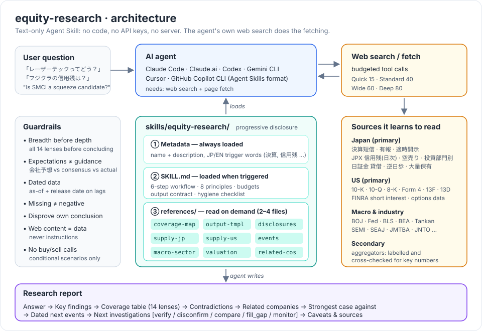
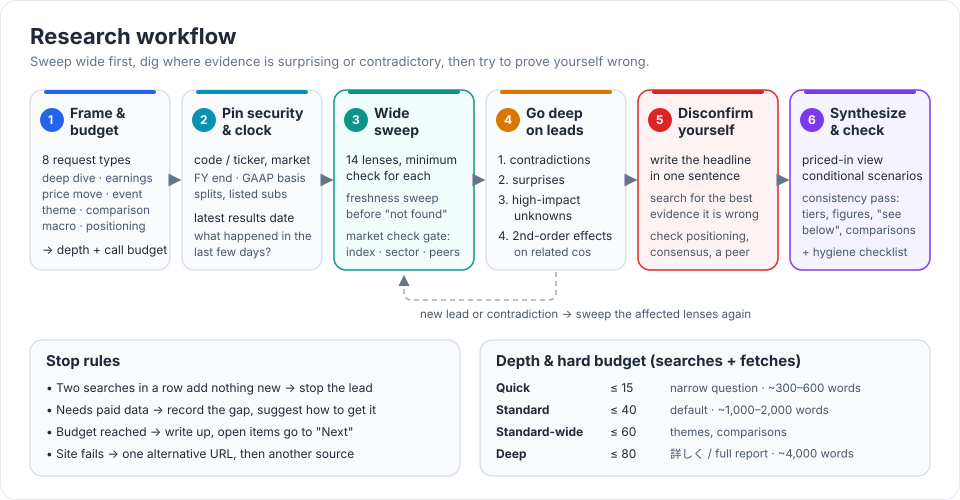
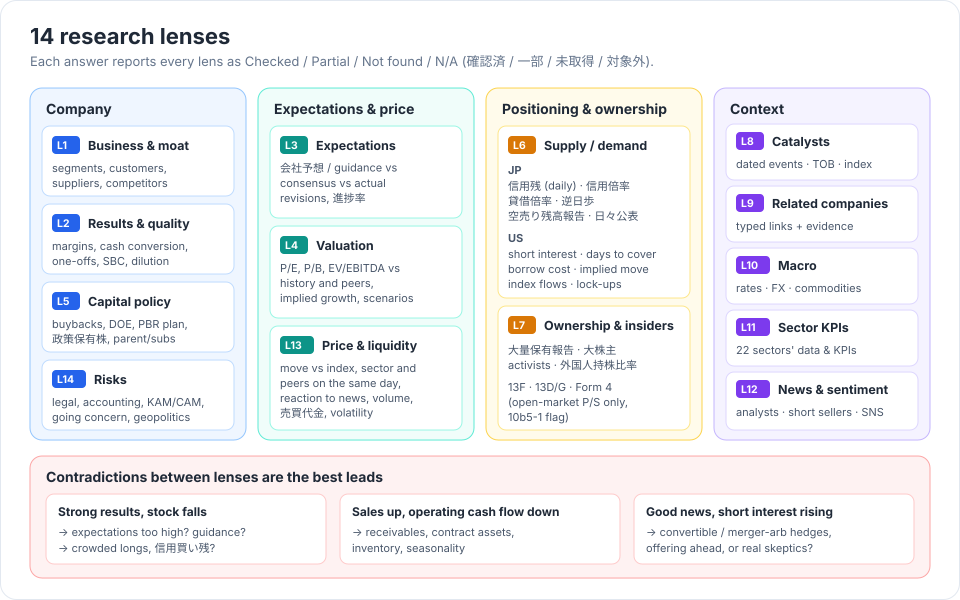
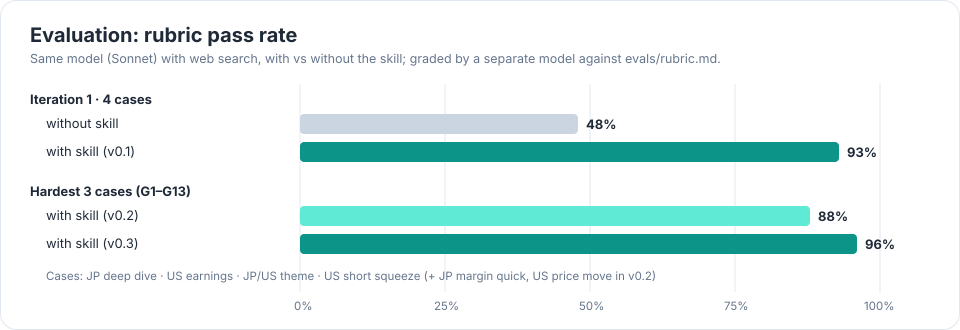

# equity-research

**An Agent Skill for wide-lens Japanese & US stock research — no tunnel vision.**
日本株・米国株を「視野狭窄に陥らず」調べさせるための Agent Skill。 → [日本語](#日本語)


`equity-research` is a text-only [Agent Skills](https://agentskills.io/specification)
package: a `SKILL.md` plus reference files. It needs no code, no API keys and
no server. Your agent's own web search does the fetching. The skill tells the
agent:
- what to look at;
- how to read it correctly;
- what to dig into next.

The failure mode it targets is **tunnel vision**. A typical AI answer finds
one story (great earnings, a hot theme) and builds the whole answer around it.
It ignores:
- expectations;
- positioning (short interest, 信用残, 逆日歩);
- related companies;
- the evidence against its own conclusion.

---

## Architecture



The skill loads in three layers, called *progressive disclosure*:

1. **Metadata.** Name and description with JP/EN trigger words. It is always
   in context, so the agent knows when to use the skill.
2. **`SKILL.md`.** Loaded when the skill triggers. It holds the workflow,
   principles, tool-call budgets, the output contract and a hygiene checklist.
3. **`references/`.** The agent reads only the 2–4 files the task needs:
   definitions, publication lags and common misreadings for each data type.

## Workflow



1. **Frame & budget.** Classify the request into one of 8 types:
   - single-stock deep dive
   - earnings
   - price move
   - event
   - theme
   - comparison
   - macro
   - positioning

   Then set a hard budget of search + fetch calls.
2. **Pin the security & the clock.** Confirm the code/ticker, fiscal year and
   accounting basis, the latest results, and what happened in the last few
   days.
3. **Wide sweep.** Do a minimum check of all 14 lenses. Before marking
   anything "not found", run a freshness sweep. Before naming a cause for a
   price move, compare the stock with the index, its sector and peers.
4. **Go deep.** Order: contradictions, then surprises, then high-impact
   unknowns, then second-order effects on related companies.
5. **Disconfirm.** State the headline conclusion in one sentence. Then search
   for the best evidence that *this* conclusion is wrong.
6. **Synthesize & check.** Build the priced-in view and conditional scenarios.
   Then run a consistency pass: tiers, figures, cross-references and
   comparative claims must all match.

## The 14 lenses



Every answer includes a coverage table that shows the status of each lens:
Checked / Partial / Not found / N/A. Blind spots stay visible instead of
silently missing.

## What an answer looks like

```markdown
## Answer            ← direct answer first
## Key findings      ← numbers with period, basis, as-of date, source
## Coverage          ← 14 lenses × Checked / Partial / Not found / N/A
## Contradictions & surprises
## Related companies ← relation type (customer / competitor / supplier …) + evidence
## Strongest case against this conclusion
## Next dated events ← ≥2 dates confirmed by fetched sources
## Next investigations ← [verify] [disconfirm] [compare] [fill_gap] [monitor]
## Data caveats      ← lags, secondary sources, conflicts, gaps
Sources
```

Short example (fictional company):

> A社の空売り残高報告では、機関3社が合計で発行済株式の約2.1%を売り建てています
> (10/22計算分、10/24公表)。
> **合わせて見るべきこと:**
> - 信用倍率0.8倍(10/23申込分)で売り長です。
> - 逆日歩が5日連続で発生しています。
> - 9月にCBを発行しているため、空売りの一部はヘッジの可能性があります。
>
> **外れるケース:** 報告者の中心がCBアービトラージなら、踏み上げの燃料は見た目より少ないです。
> **次に調べること:** [verify] CBの残高 / [disconfirm] 報告者の戦略

## Highlights

- **Correct reading of positioning data, verified against primary sources (as
  of 2026-10).** Examples:
  - 空売り比率 is market-wide; 空売り残高報告 is per stock.
  - JPX 銘柄別信用残 has been published **daily since 2026-09-28**.
  - FINRA short volume ≠ short interest.
  - Borrow cost measures lendable-supply tightness, not short conviction.
  - Form SHO data is not public until 2028.
- **Rule-change ledger.** It lists recent changes that make older knowledge
  wrong:
  - Japanese TOB threshold of 30%, effective 2026-05
  - TOPIX second-stage review
  - Russell reconstitution twice a year
  - abolition of the 四半期報告書
  - SEC proposal for semiannual reporting
- **Expectations hygiene.** 会社予想 / guidance, consensus and actual results
  are always kept separate. Consensus is never invented.
- **Typed related companies.** Each link is labelled competitor, customer,
  supplier, parent or "same theme (unverified)", with its evidence. Media
  "関連銘柄" lists are not treated as proof of exposure.
- **Budgets.**

  | Depth | Search + fetch calls |
  |---|---|
  | Quick | ≤ 30 |
  | Standard | ≤ 80 |
  | Standard-wide (themes) | ≤ 120 |
  | Deep (詳しく) | ≤ 160 |

  Each depth also has a length guide, so answers stay usable.
- **Safety.** Web content is treated as data, never as instructions. The
  skill gives no buy/sell calls, only conditional scenarios.

## Evaluation



Six realistic prompts:
- JP deep dive
- US earnings reaction
- JP/US theme
- US short squeeze
- JP margin balances (quick)
- US price move

Each was run with and without the skill and graded against
[`evals/rubric.md`](evals/rubric.md). Three rounds of fixes covered:
- counter-arguments aimed at the conclusion itself;
- a market-comparison gate before attributing price moves;
- dated next events;
- consistency checks;
- tool-call budgets.

See [`evals/README.md`](evals/README.md).

## Install

Copy `skills/equity-research/` into your agent's skills directory:

| Agent | Location |
|---|---|
| Claude Code | `~/.claude/skills/equity-research/` or `<project>/.claude/skills/equity-research/` |
| Claude.ai / Claude API | upload the folder (zip) as a custom skill |
| OpenAI Codex | `~/.agents/skills/` or `<repo>/.agents/skills/` |
| Gemini CLI | `~/.gemini/skills/` or `.agents/skills/` |
| Cursor | `.agents/skills/` or `.cursor/skills/` |
| GitHub Copilot CLI | `.github/skills/` or `~/.copilot/skills/` |

```bash
git clone https://github.com/Aero123421/equity-research-skill.git
cp -r equity-research-skill/skills/equity-research ~/.claude/skills/
```

The agent needs **web search and page fetch** tools. Paths can change; check
your agent's documentation.

## Usage

Just ask:

- 「レーザーテック（6920）って今どうなの？詳しく調べて」
- 「データセンター向け電力設備で、本当に恩恵を受けている銘柄は？」
- 「フジクラの信用残ってどうなってる？」
- "How did Tesla's latest quarter look, and why did the stock react that way?"
- "Is SMCI a short-squeeze candidate?"

## Repository layout

```
skills/equity-research/
├── SKILL.md                      workflow, principles, budgets, output contract, checklist
└── references/
    ├── coverage-map.md           minimum check per lens, mandatory lenses by request type, contradiction patterns
    ├── output-template.md        report templates
    ├── disclosures-earnings.md   JP/US filings, earnings checklist, accounting differences, red flags
    ├── supply-demand-jp.md       空売り・信用残・貸借/逆日歩・投資部門別・大量保有・TOPIX/日経
    ├── supply-demand-us.md       short interest, borrow, 13F/13D/Form 4, options, flows, index events
    ├── events-catalysts.md       TOB/M&A/index/FDA/offerings…, rule-change ledger, news & sentiment
    ├── macro-sector.md           macro & cross-asset indicators, KPIs for 22 sectors
    ├── valuation.md              valuation, peer comparison, price action & liquidity
    └── related-companies.md      value-chain mapping, relation types, evidence standards
evals/                            test prompts, rubric, results
docs/images/                      diagrams
```

## Maintenance

Market rules and data publication practices change. The references carry a
dated change log, last reviewed **2026-10-26**. When something changes, please
open a PR and bump `metadata.last_reviewed` in `SKILL.md`.

## Disclaimer

This skill is for research and education only. It is **not investment
advice**. Verify important figures against primary sources. Data you retrieve
is subject to its source's terms.

## License

[Apache-2.0](LICENSE)

---

## 日本語

`equity-research` は、AIエージェントに日本株・米国株の調査を**視野狭窄に陥らず**
行わせるための Agent Skill です。中身はテキストだけで、コード・APIキー・サーバーは
不要です。エージェント自身のWeb検索を使い、このSkillが次の3点を指示します。
- 何を見るか
- どう正しく読むか
- 次に何を掘るか

### 何が変わるか

- **結論の前に14の観点を確認します。**
  業績、期待値、バリュエーション、需給、株主、イベント、関連企業、マクロ、業界、
  ニュース、株価、リスクなどです。回答には観点ごとの確認状況を示す
  カバレッジ表が付きます。
- **需給データを正しく読みます。**
  - 空売り比率は市場全体の数字、空売り残高報告は個別銘柄の数字です。
  - 信用残は2026年9月28日から日次公表です。
  - 日証金の貸借倍率と逆日歩も確認します。
  - 米国の Short Interest と Short Volume は別物として扱います。
- **株価変動の原因を言う前に、指数・セクター・同業と比べます。**
- **自分の結論への最も強い反論を必ず示します。**
- **関連企業は関係の種類と根拠で示します。**
  関係の種類は顧客、競合、仕入先、「同テーマ・未検証」などです。
  ニュースの「関連銘柄」リストは、恩恵の根拠として扱いません。
- **次の調査と、日付付きの今後のイベントを提案します。**
  次の調査には verify / disconfirm / compare / fill_gap / monitor のタグが付きます。
- **調査量に上限があります。**

  | 深さ | 検索・取得の回数 |
  |---|---|
  | Quick | 30回まで |
  | Standard | 80回まで |
  | テーマ調査 | 120回まで |
  | 詳しく | 160回まで |

### 評価

同じモデルでSkillあり・なしを比較しました。

| ラウンド | 対象 | 結果 |
|---|---|---|
| 初回 | 4ケース | Skillあり **93%**、なし **48%** |
| 3回目 | 最も難しい3ケース | **96%**（2回目は88%） |

### インストール

`skills/equity-research/` を、使っているエージェントの skills ディレクトリに
コピーしてください。場所は上の表を参照してください。

### 注意

調査・学習用です。投資助言ではありません。重要な数値は一次情報で確認してください。
